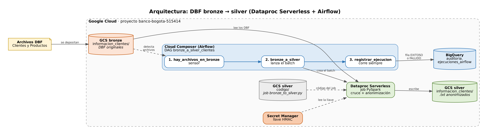
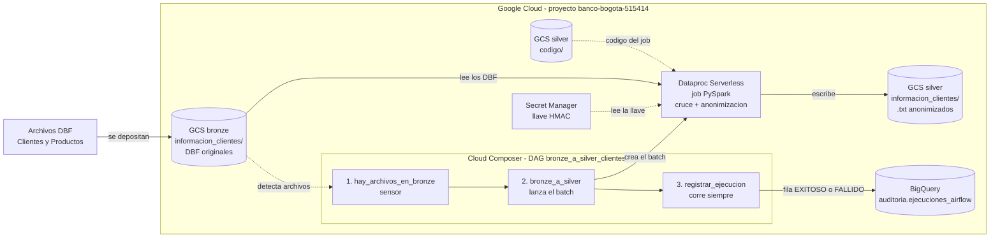

# DBF bronze → silver (Dataproc Serverless + Airflow)

```
reto4-integracion-archivos/
├── README.md
├── despliegues/
│   └── desplegar.py                    copia los archivos a GCP
├── dags/
│   └── bronze_a_silver_clientes.py     DAG de Airflow (Cloud Composer)
├── jobs/
│   └── bronze_to_silver.py             job PySpark (Dataproc Serverless)
├── docs/
│   └── arquitectura.png                diagrama (fuente: arquitectura.dot)
└── tests/                              pruebas (pytest) y DBF de ejemplo
```

El DAG espera los DBF en `gs://banco-bogota-515414-bronze/informacion_clientes/` y lanza el job, que relaciona cada producto con su cliente (`ID_CLIENTE`) y escribe en `gs://banco-bogota-515414-silver/informacion_clientes/`:
- `cliente_producto.txt`: texto delimitado por `|`, con encabezado, con cada producto y los datos de su cliente (con los datos de ejemplo: 18 filas de datos)
- `productos_sin_cliente.txt`: igual, con los productos cuyo cliente no existe (2 filas de datos: `P0019`, `P0020`)

Columnas esperadas de `cliente_producto.txt` (ya anonimizadas, ver abajo): `ID_CLIENTE|ID_PROD|TIPO_PROD|SALDO|ESTADO_PRODUCTO|NOMBRE|SEGMENTO|ESTADO_CLIENTE`. Otro delimitador: argumento `--delimiter` del job.

## Arquitectura



<details><summary>Versión editable (Mermaid)</summary>



</details>

| Pieza | Para qué sirve |
|---|---|
| **GCS bronze** | Donde se depositan los DBF originales. Es el único lugar con datos sin anonimizar. |
| **Cloud Composer (Airflow)** | Orquesta: espera los archivos, lanza el job y registra el resultado. Corre a diario y también al detectar archivos. |
| **Dataproc Serverless** | Ejecuta el job PySpark sin administrar un clúster: lee los DBF, relaciona productos con clientes, anonimiza y escribe. |
| **Secret Manager** | Guarda la llave de la anonimización; solo la cuenta del batch puede leerla. |
| **GCS silver** | Recibe los `.txt` ya anonimizados (`cliente_producto.txt` y `productos_sin_cliente.txt`) y guarda el código del job en `codigo/`. |
| **BigQuery** | Tabla de auditoría con una fila por ejecución del DAG. |

Líneas continuas: flujo de datos. Líneas punteadas: detección, código o secreto que se consulta.

## Registro de ejecuciones (BigQuery)

Cada corrida del DAG deja **una fila** en `banco-bogota-515414.auditoria.ejecuciones_airflow`, tanto si fue exitosa como si falló. La escribe la última tarea del DAG, `registrar_ejecucion`, que corre siempre (`trigger_rule=all_done`).

| Columna | Qué guarda |
|---|---|
| `id` | identificador único de la fila (uuid) |
| `nombre_dag` | `bronze_a_silver_clientes` |
| `run_id` | identificador de la corrida en Airflow |
| `tipo_ejecucion` | `scheduled` (diaria) o `manual` |
| `fecha_logica` | periodo de datos que representa la corrida |
| `fecha_hora_ejecucion` / `fecha_hora_fin` | inicio y fin (UTC) |
| `duracion_segundos` | duración total |
| `estado_ejecucion` | `EXITOSO` o `FALLIDO` |
| `tarea_fallida` | primera tarea que falló (vacío si fue exitosa) |
| `url_log` | enlace al log de esa tarea en Airflow |

```sql
SELECT nombre_dag, fecha_hora_ejecucion, estado_ejecucion, tarea_fallida, duracion_segundos
FROM `banco-bogota-515414.auditoria.ejecuciones_airflow`
ORDER BY fecha_hora_ejecucion DESC LIMIT 20;
```

- **Si el pipeline falla**, la tarea registra la fila y después falla a propósito. Sin eso, Airflow marcaría la corrida como exitosa porque la última tarea terminó bien.
- **Si no se puede escribir en BigQuery**, la tarea falla y se ve en Airflow; no se oculta el error. No reintenta, para no duplicar filas.
- **Un "Clear" y nueva ejecución** agrega otra fila: cada intento queda registrado.
- **Permisos:** `desplegar.py` crea el dataset y la tabla (sin reemplazar si ya existen) y da a la cuenta de Composer `dataEditor` solo sobre esa tabla y `jobUser` en el proyecto, necesario para ejecutar el INSERT.
- **No incluye** el detalle de errores de Spark ni los conteos del job (clientes, productos, cruzados); eso queda en los logs del batch de Dataproc.

## Anonimización (silver solo tiene datos anonimizados)

| Campo | Tratamiento | Ejemplo (ilustrativo) |
|---|---|---|
| `NOMBRE` | enmascarado: primera letra de cada palabra | `ANA MARIA TORRES` → `A** M**** T*****` |
| `ID_CLIENTE` | pseudonimizado: HMAC-SHA256 con llave secreta, 16 caracteres hexadecimales | `C0001` → `a1b2c3d4e5f60718` |
| Resto (`SALDO`, `SEGMENTO`, `TIPO_PROD`, `ESTADO_*`, `ID_PROD`) | sin cambio | |

- **El cruce se hace con los datos originales** y se anonimiza justo antes de escribir; el mismo cliente recibe siempre el mismo código, así que los cruces y conteos por cliente siguen funcionando.
- **La llave** vive en Secret Manager (`hmac-id-cliente`, versión 1). `desplegar.py` la crea una sola vez, con 32 bytes aleatorios, y nunca la sobrescribe: **cambiarla cambia todos los códigos** y rompe la continuidad con lo ya generado. Solo la cuenta del batch puede leerla, y solo esa llave. No está en el código, ni en el DAG, ni en los logs.
- **Falla cerrado:** si el job no puede leer la llave, termina con error antes de leer los datos; nunca escribe datos sin anonimizar.
- **El original sigue solo en bronze**, con el acceso que tenga ese bucket. Esta versión no permite recuperar el ID original desde silver.
- **Límite:** pseudonimizar no es anonimizar del todo. Quien tenga la llave puede recalcular los códigos, y combinaciones como `SEGMENTO` + `SALDO` exacto podrían permitir reidentificar a alguien. Conviene revisarlo con el área de protección de datos (Ley 1581 de 2012).
- **Rotación:** crear una versión nueva del secreto y cambiar `SECRETO` en el DAG a esa versión. Los códigos nuevos no coincidirán con los anteriores.

## Despliegue (Cloud Shell, proyecto `banco-bogota-515414`)

```bash
python3 despliegues/desplegar.py us-east1 st-airflow
```
Activa las APIs de Dataproc y Secret Manager, crea la llave de anonimización, da los permisos para crear el batch (ver abajo), crea el bucket silver si no existe, sube el job a `gs://…-silver/codigo/` y copia el DAG a la carpeta `dags/` de Composer (ajustando la región por usted).

El script también activa "Private Google Access" en la subred `default` (Dataproc Serverless lo exige). Si su Composer usa otra red y el script avisa que no pudo, ejecute a mano `gcloud compute networks subnets update <SUBRED> --region us-east1 --enable-private-ip-google-access`.

Después:
```bash
# Depositar los DBF en bronze y ejecutar el DAG (o esperar al día siguiente)
gcloud storage cp Clientes.dbf Productos.dbf gs://banco-bogota-515414-bronze/informacion_clientes/
gcloud composer environments run st-airflow --location us-east1 dags trigger -- bronze_a_silver_clientes

# Ver el resultado
gcloud storage ls gs://banco-bogota-515414-silver/informacion_clientes/
```

## Pruebas

```bash
pip install pytest
python3 -m pytest -q tests          # 17 pruebas, no necesitan GCP ni Airflow ni Spark
```
Cubren: el lector de DBF (con los archivos de ejemplo: 12 clientes, 20 productos, 18 cruzados y 2 sin cliente; borrados; tildes y eñes; vacíos), el script de despliegue (con `gcloud` simulado) y la estructura del DAG (con Airflow simulado).

## Si algo falla
- **El job falla al leer la llave** (`--secret`, Secret Manager o `metadata.google.internal`): confirme que `desplegar.py` creó el secreto `hmac-id-cliente` con la versión 1 y que la cuenta del batch tiene `roles/secretmanager.secretAccessor` sobre él. El job lee el secreto con la API REST usando el token de la cuenta del batch; Private Google Access en la subred es necesario.
- **`Cloud Dataproc API has not been used … SERVICE_DISABLED`**: active la API (`gcloud services enable dataproc.googleapis.com --project banco-bogota-515414`), espere unos minutos y use *Clear* sobre la tarea `bronze_a_silver` en Airflow.
- **`Permission 'dataproc.batches.create' denied`**: `desplegar.py` ya concede `roles/dataproc.editor` a la cuenta de Composer, `roles/dataproc.worker` a la cuenta del batch (por defecto la de Compute Engine) y, si son cuentas distintas, `roles/iam.serviceAccountUser` sobre la cuenta del batch. Quien ejecute el script necesita poder modificar IAM (Propietario del proyecto). Los permisos tardan 1 o 2 minutos en propagarse.
- **Acceso a los buckets**: si el batch falla leyendo bronze o escribiendo en silver, dé a la cuenta del batch `roles/storage.objectViewer` en bronze y `roles/storage.objectAdmin` en silver.
- **Subred**: el error menciona "Private Google Access" → ejecute el comando de la subred.
- Nombres de archivo: deben empezar por `Clientes` y `Productos` (da igual mayúsculas o minúsculas) y terminar en `.dbf`.

## Limpieza obligatoria de corridas anteriores

Las ejecuciones previas a la anonimización dejaron en silver **datos originales**: las carpetas Parquet `cliente_producto/` y `productos_sin_cliente/` (el `.txt` se sobrescribe solo al volver a ejecutar). Elimínelas a mano, es irreversible:

```bash
gcloud storage rm -r gs://banco-bogota-515414-silver/informacion_clientes/cliente_producto/ \
                     gs://banco-bogota-515414-silver/informacion_clientes/productos_sin_cliente/
```
